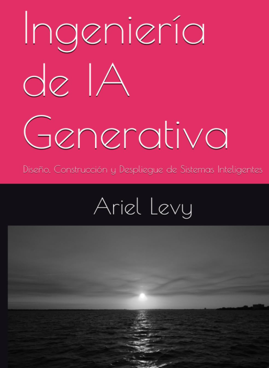

<h1 align="center">Ariel Edgardo Levy</h1>

AI Engineer · Technical Lead · Principal Architect

Turning business needs into systems and working products.

  
  
  
  
  
  

I design and build AI systems, developer tools and data platforms. My work connects
business requirements with architecture, implementation and delivery.

I bring 25+ years in enterprise technology, with hands-on work across Python, React,
C#/.NET and Azure. I lead technical teams and stay involved in the code, from APIs and
data models to evaluation and deployment.

## Book

[Ingeniería de IA Generativa: Diseño, Construcción y Despliegue de Sistemas Inteligentes](https://www.amazon.com/gp/aw/d/B0GNM9MK7C/)

I'm the author of this Spanish-language engineering book on designing, building and
operating generative AI systems. It covers RAG, agents, knowledge graphs, evaluation
and production deployment, with an emphasis on the reasoning behind architectural decisions.

## Selected projects

| Project | What I built | Engineering focus |
|---|---|---|
| [Lienzo](https://github.com/arielelevy/lienzo-doc) | A software factory with coding agents. A coordinator distributes work across Claude Code, Codex and other sessions, receives reports and checks the results. | Multi-agent coordination, process integration, WebSockets, project memory and evidence-backed delivery. [Architecture](https://arquitectura-lienzo.ariel-e-levy.chatgpt.site/). |
| [openSeec](https://github.com/arielelevy/openseec-doc) | Repository security analysis combining local detection engines, scan history and optional AI investigation. | SAST, secrets and dependency analysis, tool provenance, explicit coverage and isolation from the code being scanned. |
| [chesstudia](https://github.com/arielelevy/chesstudia-doc) | A chess study platform connecting game analysis, source-backed explanations, training and spaced repetition. | React, FastAPI, PostgreSQL, hybrid and positional RAG, deterministic engine validation and Azure deployment. [Architecture](https://github.com/arielelevy/chesstudia-doc/blob/main/docs/arquitectura.md). |
| [FDD for AI coding agents](https://github.com/arielelevy/fdd) | A development workflow with one feature card, a living domain map, milestones and file ownership. | Session continuity, explicit scope and evidence before integration. |
| [motor-logico](https://github.com/arielelevy/motor-logico) | A standalone SWI-Prolog reasoning engine with JSON contracts and proof traces. | Explicit rules, provenance and conclusions that retain their supporting facts. |
| [Data Agent Client](https://github.com/arielelevy/dataagent-client) | A Microsoft Teams app for natural-language queries to Fabric Data Agents. | Streaming responses, DAX visibility, React and enterprise identity. |
| [Logmon](https://github.com/arielelevy/logmon) | A terminal monitor that brings backend and worker logs together through Redis Pub/Sub. | Python, Rich, background subscription and interactive source/level filtering. |

Some products have private application code. Their public repositories document
the architecture, capabilities and limits. Licensing is specified in each repository.

## How I approach AI engineering

- Give models a defined role and validate consequential outputs with deterministic tools.
- Build retrieval around the domain, combining semantic search with structured evidence.
- Track model usage, failure modes and provenance alongside the user experience.
- Use coding agents with clear ownership, review and reproducible checks.
- Keep architecture proportional to the product, its operating constraints and its cost.

## Experience

My background spans AI engineering, industrial systems, enterprise architecture and data
platforms. I have worked at Globant, smartBI, Ledsage, Baufest, Tenaris and Accenture,
with AI consulting engagements at Bixen and Octostar.

Recent work includes AI-assisted delivery, RAG for forensic document analysis, evaluation
with RAGAS and LangSmith, and production observability with Langfuse. My data work covers
Microsoft Fabric, Azure and Power BI, from ingestion and modeling to executive analytics.

## Technical range

| Area | Tools and practices |
|---|---|
| AI engineering | RAG, hybrid retrieval, reranking, multi-agent systems, LangGraph, OpenAI/Azure OpenAI, evaluation and observability. |
| Software | Python, FastAPI, asyncio, React, TypeScript, C#/.NET, REST, WebSockets and OAuth. |
| Data | PostgreSQL, pgvector, SQL Server, Microsoft Fabric, Power BI and search indexes. |
| Cloud and delivery | Azure, AWS, Docker, Kubernetes, CI/CD and infrastructure design. |

## Background

Information Systems Engineering graduate from Universidad Tecnológica Nacional, with
honors. Certifications include Microsoft Power BI Data Analyst Associate, Fabric Analytics
Engineer Associate, Microsoft Certified Trainer and PMP.

Based in Argentina. Spanish is my native language; I use English for technical writing
and collaboration with international teams.

[LinkedIn](https://www.linkedin.com/in/arieledgardo/) ·
[More projects at innerbi](https://github.com/innerbi)
